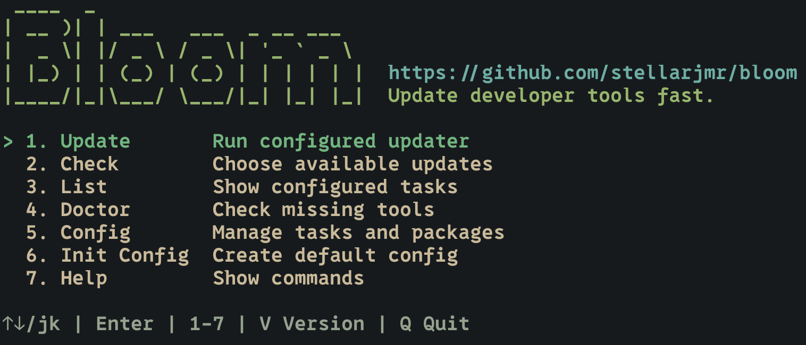

# Bloom

<p align="center">
  
</p>

Bloom is a config-driven terminal updater for developer tools on macOS. The command is intentionally short: `bm` opens the menu, and `bm update` runs the updater directly.



## Install

```bash
brew tap stellarjmr/tool
brew install stellarjmr/tool/bloom
```

The Homebrew formula installs prebuilt release binaries, so Go is only needed when building from source.

## Commands

```bash
bm                           # open the interactive menu
bm check                     # list available package updates
bm update                    # run enabled update tasks
bm update --dry-run          # inspect selected tasks without updating
bm update --only nvim        # run one task
bm update --package npm:pkg  # run one package from a task
bm update --skip npm         # skip a task
bm remove                    # remove packages with their package manager
bm remove --list             # list removable packages as TSV
bm remove --package npm:pkg  # remove one package from a task
bm uninstall                 # remove apps and their leftovers
bm uninstall --list          # list installed apps as TSV
bm uninstall --dry-run --app /Applications/Foo.app
bm clean                     # move cleanable cache files to Trash
bm clean --dry-run           # preview cleanable files without moving them
bm clean --whitelist         # choose protected clean whitelist entries
bm history                   # show recent clean and uninstall activity
bm list                      # list configured tasks
bm doctor                    # show available and missing tools
bm config                    # open the interactive config menu
bm config path               # print config path
bm config init               # create ~/.config/bloom/config.toml
```

Bloom uses portable terminal symbols so the interface works in standard terminal fonts.

## Default Tasks

The default task set updates everything Bloom can detect:

- `brew`: Homebrew formula updates
- `cask`: Homebrew cask updates
- `amp`: `amp update`
- `claude`: `claude update` for Claude Code's native install
- `agy`: `agy update` for the Antigravity CLI
- `yazi`: all Yazi package updates, including plugins and flavors
- `nvim`: Neovim plugin updates for lazy.nvim/LazyVim and `vim.pack`
- `mason`: Mason package updates
- `npm`: global npm package updates

Missing tools are skipped during `bm update` and are not counted in the progress total. The `claude` task runs only when `claude` resolves into Claude Code's native versions directory (`$XDG_DATA_HOME/claude/versions`, by default `~/.local/share/claude/versions`) or the legacy `~/.claude/local` install. A Homebrew cask or npm copy is skipped with a note, because `claude update` would hand it to the package manager that the `cask` or `npm` task already runs. The `agy` task runs `agy update` for the copy that the official installer places in `~/.local/bin` or the directory given to its `--dir` flag. An `agy` linked from the `antigravity-cli` Homebrew cask is skipped with a note, because the `cask` task already upgrades it. For Homebrew updates, Bloom refreshes Homebrew metadata before checking outdated formulae and casks, so packages from tapped repositories are included.

## Remove packages

`bm remove` removes packages using the owning package manager only. It does not delete package files directly and does not remove macOS app leftovers.

The interactive Remove flow lives above Uninstall in the main menu. It lists removable package sets from Config → Packages, then calls official removal APIs/commands such as `brew uninstall`, `ya pkg delete`, `npm uninstall -g`, and Mason's package uninstall API.

Homebrew casks and other `.app` bundles are handled by `bm uninstall`, which includes application leftovers. Neovim plugin install/removal is config-driven, so remove plugins from your Neovim configuration instead of using `bm remove`.

## Clean

`bm clean` moves safe, rebuildable cache and temporary files to the macOS Trash. It is conservative by design: protected system paths, Trash, iCloud/Mobile Documents, Apple Notes, Apple Mail, Keychains, Safari/Cookies, browser history/cookies, LaunchAgents/LaunchDaemons, Messages, Reminders, Photos libraries, Finder metadata, Git's config lock and config backups, active application/developer-tool caches, live SQLite families, and other high-value data are skipped or rejected instead of cleaned. Hard safety entries remain protected even when loading an older or replacement-style whitelist, and activity is checked again immediately before a Trash move. Open-file checks require `lsof` visibility that includes root-owned processes, and incomplete downloads are rebound after sizing and at the action boundary. If a process, SQLite, or open-file safety probe times out or is interrupted, Bloom preserves the current target and stops the remaining clean run rather than continuing with partial evidence.

Google's `~/Library/Caches/GIPPseudonymousID` identity store and `~/Library/Caches/CCTClearcutLogger` log queue are never cleaned: their names carry no owner bundle ID, and removing them while Gemini runs starts an unbounded disk write loop.

Jupyter's `~/.jupyter/runtime` folder is never cleaned: its files are the connection details of running servers and kernels, not a cache.

Browsers and test runners that tools install under `~/Library/Caches` and launch from there are never cleaned either: Playwright's `ms-playwright`, Camoufox's `camoufox`, and Cypress's `Cypress`. Removing them breaks every run until a download of a gigabyte or more.

Crash reports inside `~/Library/Logs/DiagnosticReports` are cleanable, but the directory itself stays: macOS's crash reporter cannot recreate it under its sandbox and would silently stop saving later reports.

The interactive flow lives at menu item 5. Use `bm clean --dry-run` to preview targets first, and use Config → Clean or `bm clean --whitelist` to choose additional whitelist entries that Bloom should protect. The pip and Yarn v1 rows include the macOS cache locations those tools actually use under `~/Library/Caches`. A Bun row protects Bun's install cache in `~/.bun/install/cache`. Sizes use physical disk occupancy; each directory probe is time-bounded, and Bloom skips an item whose complete size cannot be measured.

Rust cleanup honors validated absolute `CARGO_HOME` and `RUSTUP_HOME` values, including version-manager layouts. It targets only redundant Cargo registry archives and Rustup downloads. Registry sources and indexes, Cargo git state, installed binaries, toolchains, and toolchain documentation stay untouched; active Rust builds and cache roots that escape their selected tool home are skipped.

Bloom also keeps complete dependency, toolchain, model, and environment stores off the automatic clean path. This includes Maven repositories, Go modules, SBT/Ivy and Cabal state, Conda package roots, Ollama models, llama.cpp's downloaded models (`~/Library/Caches/llama.cpp`, or `LLAMA_CACHE`), Buzz's Whisper models and plugins (`~/Library/Caches/Buzz`), R renv libraries, downloaded model/data stores, Deno state, and Poetry virtual environments. Precise rebuildable leaves such as Go build output and Poetry's macOS `artifacts` and package-download `cache` children remain eligible independently.

uv's cache (`~/.cache/uv`) and Bun's install cache (`~/.bun/install/cache`) wait while `uv`, `uvx`, `bun`, or `bunx` runs, including tools and MCP servers that `uvx` started from environments inside the uv cache. VS Code's Chromium caches under `~/Library/Application Support/Code` likewise wait while a process from `Visual Studio Code.app` or a `Code Helper` process runs, which also covers a renamed bundle.

pnpm cleanup covers store generations under both `~/Library/pnpm/store` and the mise/XDG-style `~/.local/share/pnpm/store`. Bloom moves each generation to Trash and skips both roots while pnpm or Corepack is active; redirected roots still fail path validation.

Codex cleanup is limited to exact abandoned staging locations: Sparkle update entries and marketplace directories with the `openai-bundled.staging-`, `marketplace-upgrade-`, or `marketplace-add-` prefixes. Bloom keeps newer pending desktop updates, completed marketplaces, backups, sessions, credentials, and configuration. Unknown versions fall back to a 30-day age gate, and any active Codex/Sparkle process, open staging file, path redirection, or changed identity stops the Trash move.

Autodesk Fusion cleanup considers only direct 40-character version directories under its standard `webdeploy/production` root. Bloom resolves and rebinds Fusion's current alias, validates the bundle ID, numeric build version, and executable, and moves only strictly older versions to Trash. Equal, newer, malformed, redirected, active, open, or changed bundles stay in place.

## Uninstall

`bm uninstall` removes a macOS `.app` bundle plus the leftovers most apps drop into `~/Library` (Application Support, Caches, Containers, Group Containers, HTTPStorages, WebKit, Logs, Saved Application State, Application Scripts, Preferences, ByHost preferences, LaunchAgents, and Cookies). The app list uses the bundle's localized Finder-facing name when available, while cleanup matching continues to use only the bundle basename and identifiers. Name-based matches are literal: Bloom accepts the bundle basename, plus its no-space, underscore, and hyphen spellings when the name has spaces, only in Application Support, Caches, Logs, and Saved Application State. A different product whose name extends the app's, such as `Telegram Desktop` for `Telegram`, and a vendor component inside another bundle ID are never treated as the app's leftovers. Bloom also scans the app for embedded helper bundles (XPC services, app extensions, and login-item helpers) and cleans their leftovers by exact bundle ID, while skipping protected identifiers so removal stays scoped to the app's own data. A bundle-ID match must contain the complete identifier on dot boundaries, such as `com.example.App`, `com.example.App.helper`, or `TEAMID.com.example.App.widgets`; containers that only share a vendor's Team ID or domain prefix, such as Microsoft's shared Office, sign-in, and Defender group containers, stay in place. The exact shared developer roots `~/.local`, `~/.config`, and `~/.cache` are rejected both during discovery and at the final Trash boundary.

Steam's name matches `~/Library/Application Support/Steam`, which holds its installed game library and local saves. Bloom keeps that folder and everything inside it when Steam is uninstalled, and the summary says so. Homebrew's `steam` cask zaps the same folder, so Bloom runs that cask's uninstall without `--zap`.

A cask's zap stanza can reach well past the app's Library data: every Ableton Live cask trashes `~/Music/Ableton`, Actual's trashes `~/Documents/Actual` with its budget files, OmniGraffle's trashes its iCloud Drive folder under `~/Library/Mobile Documents`, Dropbox's trashes `~/Library/CloudStorage/Dropbox`, and over a hundred casks trash their folder in `~/.config`. Before Homebrew's uninstall, and again right before it runs, once the app has quit, Bloom reads the uninstall and zap steps Homebrew will run, from the cask's install receipt, its installed caskfile, and its current definition. When only the zap would trash or delete something that exists in Desktop, Documents, Downloads, Movies, Music, Pictures, Public, iCloud Drive (`~/Library/Mobile Documents`), `~/Library/CloudStorage`, `~/.config`, or data Bloom keeps, Bloom runs `brew uninstall --cask --force <token>` without `--zap` and moves its own leftover list to Trash; the summary names what the zap would have taken. A few casks' plain uninstall steps reach such data too, such as Final Fantasy XIV's folder under `~/Documents/My Games`, and Homebrew runs those with or without `--zap`, so Bloom refuses the cask and asks you to move that data first. Steps Bloom cannot read stop the cask too. `rmdir` entries are left to run, since Homebrew removes those folders only when they are empty.

Crash reports are matched by the app's executable or name. An executable still named `Electron` identifies no particular app, so Bloom falls back to the app's own name for crash reports and counts only processes inside the selected bundle when it checks whether the app is running.

For apps whose data name extends the display name in the final Bundle ID component, Bloom also checks two literal variants. For example, `AyuGram` with `one.ayugram.AyuGramDesktop` can match `AyuGramDesktop` and `AyuGram Desktop`. This derivation requires a valid Bundle ID, a sufficiently long camel-case leaf that extends the app's own name at an uppercase-or-digit boundary, and exact paths only—no globs or fully re-split product names.

Before any uninstall side effect, Bloom binds the selected bundle's on-disk identity and scans its application roots again for other `.app` copies with the same Bundle ID. This includes iOS/iPadOS-style `Wrapper/*.app/Info.plist` identities; an unreadable or malformed candidate makes the scan incomplete. For a non-Homebrew app with a sibling copy, Bloom moves only the explicitly selected bundle to Trash and preserves shared leftovers, processes, login items, and Dock entries. For a Homebrew cask, Bloom refuses the uninstall instead of running the required `--zap` against data that a sibling may still use. An incomplete sibling scan is treated the same conservative way, and the scan is repeated at the action boundary.

The same scan looks for other builds of the app. A build's name differs only by a release channel, such as `Firefox` and `Firefox Nightly` or `Zed` and `Zed Preview`, or its Bundle ID extends the selected one at a dot, such as `com.google.Chrome.canary` for `com.google.Chrome`. While such a build is installed, Bloom keeps the folders named after the family's shared base name, the name-matched crash reports, and every leftover that carries the other build's Bundle ID, so uninstalling Firefox no longer takes the profiles Nightly uses and uninstalling Chrome no longer takes Canary's caches. A channel build's own folders, such as `Firefox Nightly`, still go with it. When the builds share an executable name, Bloom counts only processes inside the selected bundle. Channel casks zap each other's folders and preferences, so Bloom refuses a Homebrew cask while another build is installed, and a build that appears between the plan and the action stops the uninstall.

The interactive flow lives at menu item 3:

- All apps start unselected. `Space` toggles. `Enter` removes the cursor item when nothing is selected, or every selected item otherwise.
- Each row shows the app name, physical on-disk size, and last-used time (`kMDItemLastUsedDate`, with bundle mtime as a fallback). CJK and fullwidth names align by display width.
- Copies that share a Bundle ID are listed once. A hidden copy whose name starts with a dot, such as the `.Aegis-backup-1.app` a manual reinstall can leave beside `Aegis.app`, never stands in for the visible app; it is listed only when no visible copy exists.
- The summary lists every removed path under each app (`✓` removed, `·` would-remove).

Per-app cleanup runs in this order so brew can detect and clean its own metadata and cask-defined zap leftovers:

1. Bind the selected bundle identity, scan for same-Bundle-ID copies, and verify Homebrew ownership; repeat those checks immediately before acting.
2. Quit the app and unload its `LaunchAgents` when no sibling copy may depend on them. A user LaunchAgent belongs to the app only when it is named `<bundleID>.plist` or when launchd's `Program` (or `ProgramArguments[0]`) is an executable inside the selected bundle. An agent whose label merely extends the bundle ID, or one that only mentions the app, for example in `WatchPaths`, stays loaded and in place, and each planned plist is checked again before it moves to Trash. Before sending either `TERM` or `KILL`, Bloom revalidates the process start identity and executable inside the selected bundle so a reused PID cannot redirect the signal.
3. Detect the Homebrew cask via the `<prefix>/Caskroom/<token>/<version>` layout (resolved-symlink → bundle-name search → `brew list`/`info` fallback), check its uninstall and zap steps, and run `brew uninstall --cask --force --zap <token>`, or the same without `--zap` when only the zap would reach your files, then verify with `brew list --cask`. If brew fails, still lists the cask, or cannot list casks at all, for example before the Xcode license is accepted, Bloom stops for that app and shows Homebrew's own error instead of moving the bundle itself, so a later `brew upgrade` cannot reinstall the app from the receipt left behind. Homebrew zap may remove extra cask-defined support or configuration files; Bloom then moves any remaining curated leftovers to Trash.
4. Move the app bundle to the current user's Trash. Root-owned bundles, including many Mac App Store apps, may request terminal administrator authentication; Bloom still moves the bundle to Trash rather than permanently deleting it.
5. Remove the matching `~/Library` entries only after the app bundle is gone, then remove its Login Item and unregister the selected LaunchServices path. Bloom checks the app path again before each of these steps, before every Trash retry, and before the Dock cleanup at the end of a batch. If anything reappears there once the bundle has moved, for example from an updater or a quick reinstall, or if the path cannot be checked, Bloom stops and leaves the remaining data, Login Item, LaunchServices record, and Dock tile in place.

Each best-effort teardown step runs under its own time limit: 30 seconds for the graceful quit, so the app's own save prompt can still be answered, and 5 seconds for unloading LaunchAgents, removing the Login Item, booting out helpers, and editing the Dock. A step that times out, for example while an Automation permission prompt is waiting, is skipped for that app and the uninstall continues.

Dry runs and uninstall summaries print the exact Homebrew command, with or without `--zap`, when a cask is detected.

After the batch completes Bloom rewrites the Dock plist, restarts Dock when needed, garbage-collects stale LaunchServices records, and runs `brew autoremove` if any cask was removed. It unregisters each removed bundle directly and does not force a domain-wide LaunchServices rebuild, which could terminate unrelated active app extensions or network tunnels.

Apple system bundles (Finder, Mail, Safari, etc.) are protected and never appear in the menu.

Security, device-management, and remote-access apps that install their own daemons, privileged helpers, or system extensions are refused with a pointer to the vendor's own uninstaller, because moving only the app to Trash would leave those components running. This covers CrowdStrike, SentinelOne, ESET, Jamf, GlobalProtect, Cisco Secure Client, TeamViewer and TeamViewer Host (QuickSupport, QuickJoin, and TeamViewer Meeting are plain apps and uninstall normally), Adobe Genuine Service, Alibaba Cloud Security, and the Avast, AVG, Malwarebytes, Bitdefender, Intego, Kaspersky, Norton, and Trend Micro security suites. Apps are recognized by bundle ID, and the Bitdefender, Intego, Norton, and Trend Micro IDs are not yet confirmed against the shipping apps, so a copy with another ID is treated as an ordinary app.

## History

`bm history` shows recent clean and uninstall activity from `~/Library/Logs/bloom`. Clean history reuses Bloom's clean log; uninstall history groups confirmed uninstall commands, Bloom-moved paths, and failed paths by operation for readability. Dry-run plans are not written to the uninstall history, and `--limit` limits the underlying history events before grouping. Logged names spell control characters as `\n`, `\r`, `\t`, or `\xHH`, so a crafted filename cannot forge a history record or send terminal control sequences; `bm history` escapes rows written by older versions the same way, and backslashes stay literal.

## Config

Default path:

```bash
~/.config/bloom/config.toml
```

Create it with:

```bash
bm config init
```

Bloom uses built-in defaults only when no config exists. If the config path is a broken symlink, runs through a broken directory link, or sits below something that is not a directory, every command, including `bm clean`, stops with a config error instead of silently dropping your settings and whitelist.

A config saved by an earlier version picks up a newly added default task, such as `claude` or `agy`, when its `order` does not list the task and the file has no `[tasks.<name>]` section for it, even if the `order` was edited by hand. Leaving an older task out of the `order` turns off only that task. Set `enabled = false` under `[tasks.claude]` or `[tasks.agy]` to turn a new task off.

The config controls task order, enable/disable switches, per-task package `include`/`exclude` filters, the clean whitelist, progress width, and color output. Empty package filters mean update every detected package. Bloom also disables ANSI styling automatically when output is redirected or `TERM=dumb`; any non-empty `NO_COLOR` still disables styling explicitly. Run `bm config` to manage Tasks, Packages, Clean whitelist entries, List, Doctor, Path, and Reset with the interactive menu, or edit the TOML directly. See `config.example.toml`.

## Neovim

Bloom supports both common plugin paths:

- LazyVim/lazy.nvim: detects `lazy-lock.json` and runs headless `lazy.sync({ wait = true, show = false })`.
- Native `vim.pack`: detects `nvim-pack-lock.json` and runs headless `vim.pack.update(..., { force = true })`.

If both lockfiles exist, lazy.nvim runs first and `vim.pack` runs second.
